# Launchpad 27 OS

The classic Launchpad, back on macOS 27. Apple removed Launchpad in macOS 26 and replaced it with the Apps view in Spotlight: no folders, no order of your own. Launchpad 27 OS brings back the full-screen grid of all your apps, with your pages, your folders and your order.

**[Download Launchpad-27-OS-1.2.dmg](https://github.com/Toys-D/Launchpad-27-OS/releases/download/v1.2/Launchpad-27-OS-1.2.dmg)** · macOS 27 · Apple Silicon · free · *[Russian version below](#по-русски)*

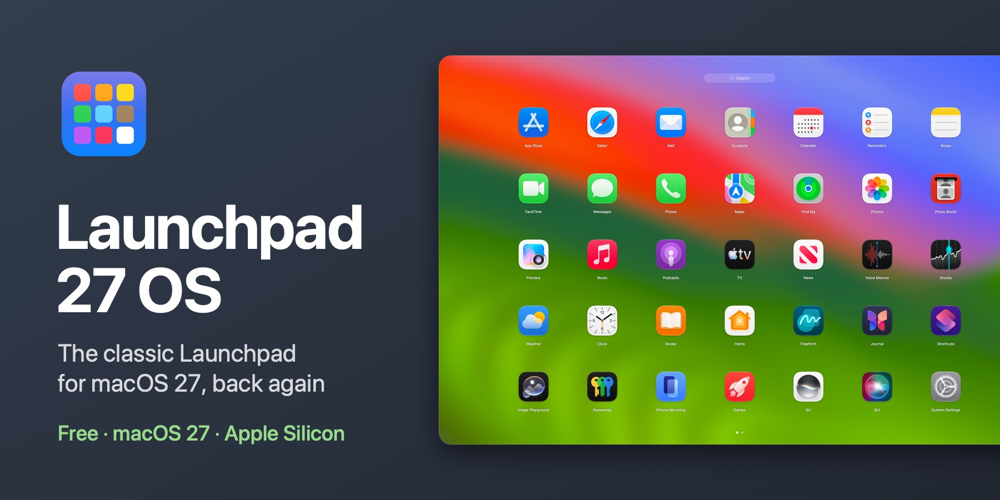

| | |
|:---:|:---:|
| 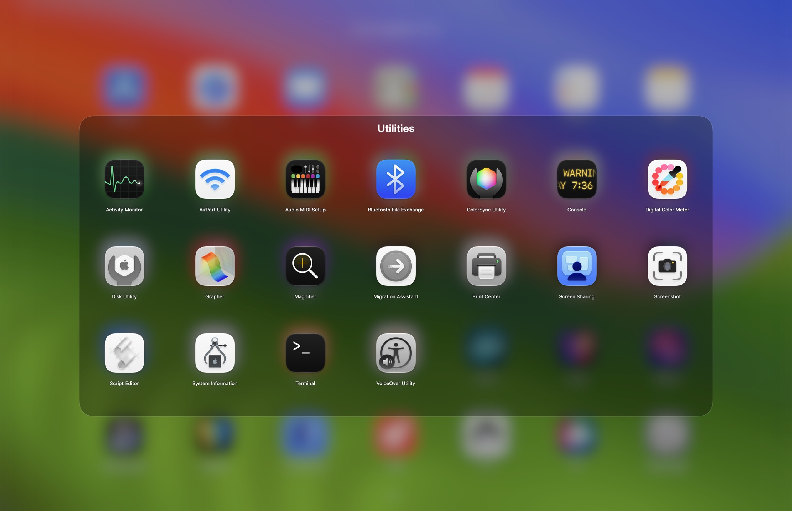 | 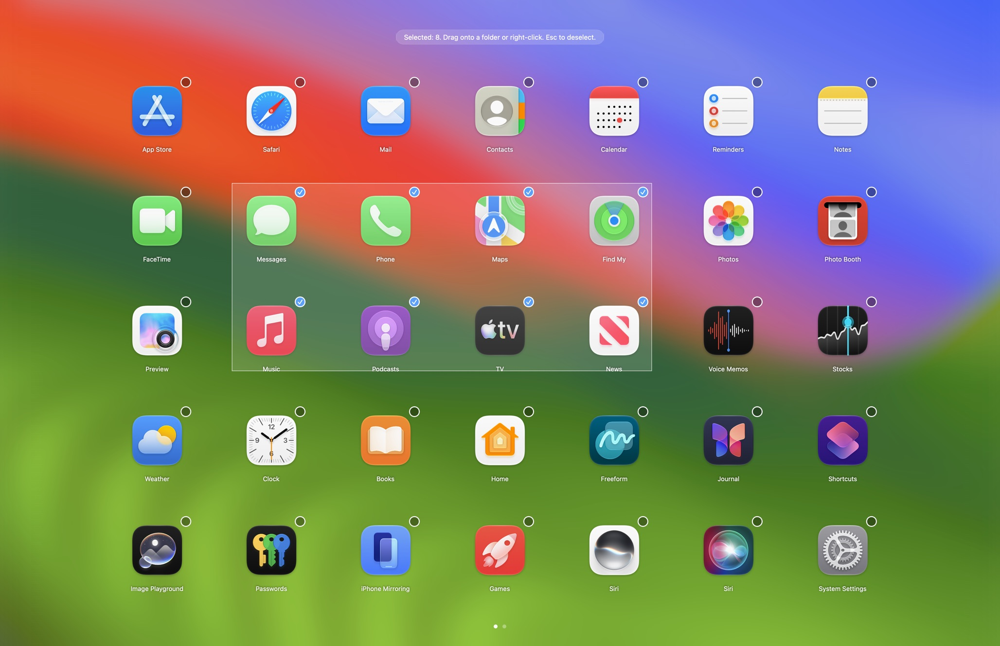 |
| **Folders:** drop one app on another, folders inside folders | **Select a rectangle:** drag from an empty spot, move them all at once |
| 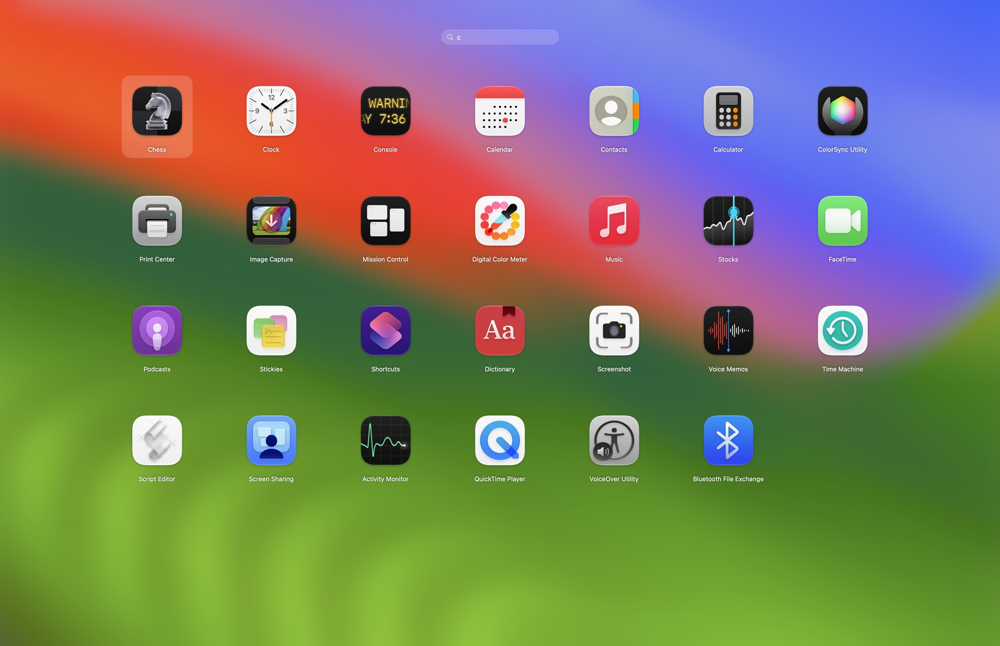 | 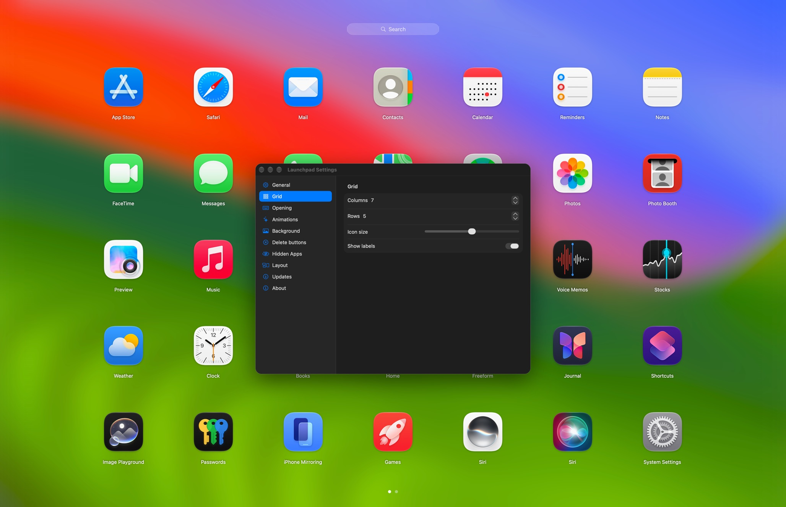 |
| **Search as you type:** Return opens the first result | **Live settings:** every change shows on the grid at once |

## Feels like the Launchpad you know

Pinch with your thumb and three fingers, press **F4**, or click the Dock icon, and every app is in front of you. Swipe between pages, type to search, drag an icon onto another one to make a folder. Your old Launchpad folders and order come back on the first launch, if the Mac still has its database.

## What it does

- **The full-screen grid.** All your apps over the blurred wallpaper, with pages, page dots and a search field. Columns, rows, icon size and labels are yours to choose.
- **Opens the way you like.** The Dock icon, F4 or any shortcut you choose, a pinch with the thumb and three fingers on the trackpad, or a hot corner.
- **Folders.** Drop an app on another to make a folder, rename it, page through it. Folders can hold folders.
- **Many icons at once.** Select with ⌘-click or by dragging a rectangle from an empty spot, then move the selection to any page or into a folder in one go.
- **Search.** Starts as you type, by the app names you see in your language; Return opens the result.
- **Tidy by itself.** New apps appear on their own, deleted apps disappear. Apps you never use can be hidden and brought back from Settings.
- **Your old layout.** On the first launch, folders and order are imported from the old Launchpad if its database is still on the Mac.
- **Live settings.** Settings open over Launchpad, so every change to the grid, icons and background is visible at once.
- **Updates itself.** Checks GitHub once a week; one click in Settings ▸ Updates installs the new version.
- **11 languages:** English, Spanish, German, French, Italian, Portuguese, Japanese, Chinese, Korean, Ukrainian and Russian, following the system language.

## Install

1. Download the DMG from the [releases page](https://github.com/Toys-D/Launchpad-27-OS/releases/latest), open it and drag **Launchpad** into Applications.
2. Open Launchpad. The first time, macOS asks for your permission; see below.
3. Drag Launchpad from Applications to the Dock.

### Why macOS asks for permission on the first launch

My apps are not in the Mac App Store, and I don't pay Apple's yearly developer fee ($99), so Apple does not sign or notarize them. macOS blocks every such app the first time it is opened; this says nothing bad about the app itself. Allow it once, and from then on it opens like any other app.

**macOS 15 and later:**

1. Double-click **Launchpad** in Applications. macOS says it cannot verify the app: press **Done**, not "Move to Trash".
2. Open **System Settings ▸ Privacy & Security**.
3. Scroll down to **Security**. Next to the message that Launchpad was blocked, press **Open Anyway** (the button stays there for about an hour after the attempt).
4. Confirm with your password or Touch ID and press **Open Anyway** once more.

macOS remembers the choice: this copy of Launchpad opens by itself from now on. A newer version downloaded later is allowed the same way.

**Or in Terminal**, on any version: `xattr -dr com.apple.quarantine "/Applications/Launchpad.app"` removes the "downloaded from the internet" mark, and Launchpad opens without the warning.

## How to use

- **Open:** the Launchpad icon in the Dock, F4, a pinch with the thumb and three fingers, or a hot corner (Settings ▸ Opening). If the trackpad's own pinch gesture is on in System Settings, turn it off, or both will react.
- **Close:** Esc, a click on an empty spot, or opening an app.
- **Pages:** swipe on the trackpad, scroll the mouse wheel, or ⌘← / ⌘→.
- **Arrange:** drag an icon; drop it on another app to make a folder. Press and hold an icon, or hold Option, to make the icons jiggle and delete apps with ×.
- **Right-click an icon:** Put in Folder, Select, Hide from Launchpad, Show in Finder, Delete…; a folder can also be renamed, and an app inside a folder can be taken out.
- **Several at once:** ⌘-click icons or drag a rectangle from an empty spot. Then drag the selection to any place, or right-click it for Put in Folder and New Folder. Esc deselects.
- **Settings:** Launchpad ▸ Settings… (⌘,) or right-click the Dock icon. Sections on the left: General, Grid, Opening, Animations, Background, Delete buttons, Hidden Apps, Layout, Updates and About.

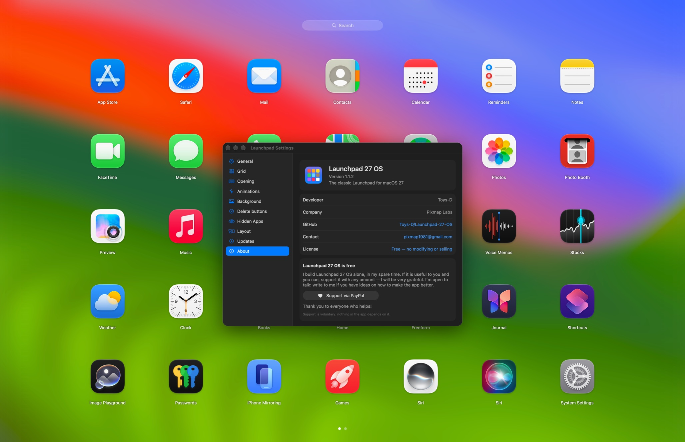

## Support the project

Launchpad 27 OS is free. I build it alone, in my spare time, because the Mac deserves its Launchpad back. If it is useful to you and you can, support it with any amount: that is what lets me spend more of my time on it. I will be very grateful.

**[Support via PayPal](https://www.paypal.com/cgi-bin/webscr?cmd=_xclick&business=pixmap1981%40gmail.com&item_name=Launchpad+27+OS&currency_code=USD)** · pixmap1981@gmail.com · Support is voluntary; nothing in the app depends on it.

## Get in touch

Bugs, questions, ideas: **[pixmap1981@gmail.com](mailto:pixmap1981@gmail.com?subject=Launchpad%2027%20OS)**, or open an [issue](https://github.com/Toys-D/Launchpad-27-OS/issues). I'm open to talk and always glad to hear how to make the app better.

## License

Launchpad 27 OS is free: use it at home and at work and share the original DMG. Modifying, reverse engineering and selling it are not allowed. See [LICENSE](LICENSE).

**Toys-D · Pixmap Labs**

---

## По-русски

**Launchpad 27 OS** — классический Launchpad, снова в macOS 27. Apple убрала Launchpad в macOS 26 и заменила его просмотром «Программы» в Spotlight — без папок и без своего порядка. Launchpad 27 OS возвращает полноэкранную сетку всех программ: ваши страницы, ваши папки, ваш порядок.

**[Скачать Launchpad-27-OS-1.2.dmg](https://github.com/Toys-D/Launchpad-27-OS/releases/download/v1.2/Launchpad-27-OS-1.2.dmg)** · macOS 27 · Apple Silicon · бесплатно

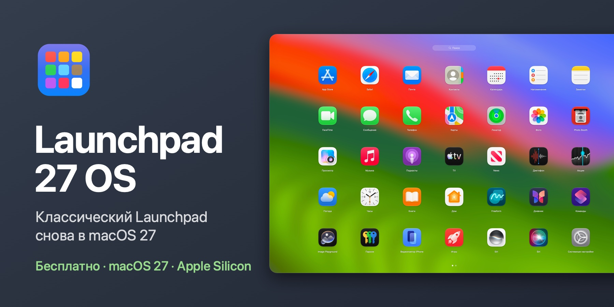

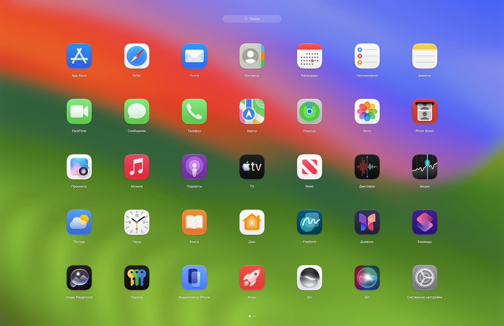

| | |
|:---:|:---:|
| 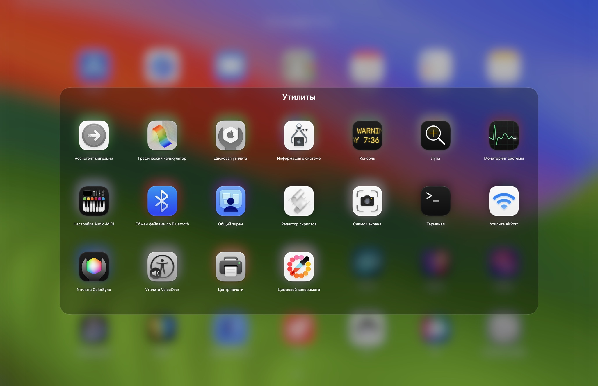 | 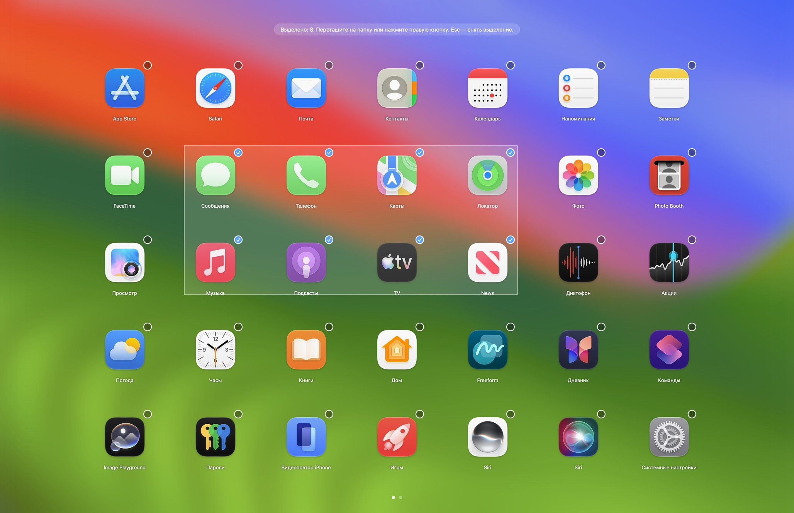 |
| **Папки:** программа на программу — и папка готова, в папке могут быть папки | **Выделение рамкой:** потяните с пустого места и перенесите все разом |
| 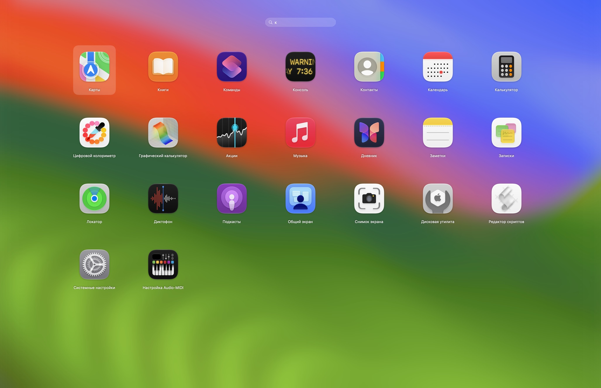 | 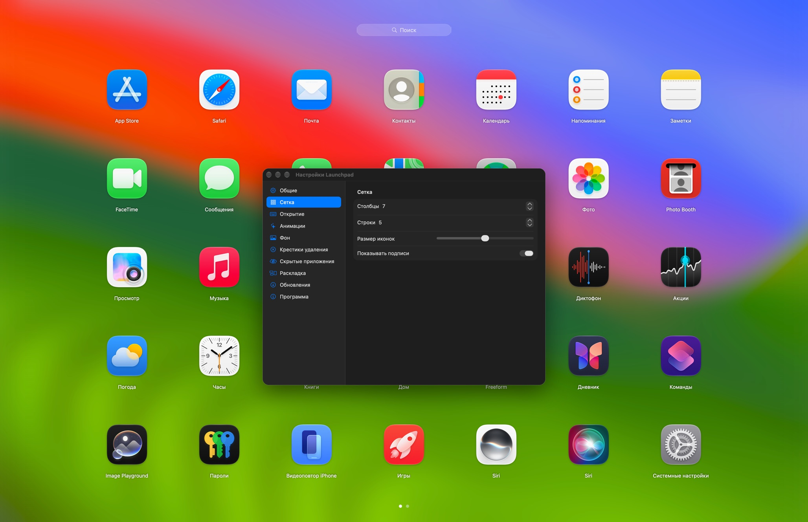 |
| **Поиск при наборе:** Return открывает первое найденное | **Живые настройки:** каждое изменение сразу видно на сетке |

### Тот самый Launchpad

Сведите большой и три пальца, нажмите **F4** или щёлкните значок в Dock — и все программы перед вами. Листайте страницы, набирайте название для поиска, бросьте иконку на другую — получится папка. Папки и порядок старого Launchpad вернутся при первом запуске, если на Mac осталась его база.

### Возможности

- **Сетка на весь экран.** Все программы поверх размытых обоев, со страницами, точками страниц и полем поиска. Число столбцов и рядов, размер иконок и подписи настраиваются.
- **Открывается как удобно.** Значок в Dock, F4 или любое сочетание на ваш выбор, сведение большого и трёх пальцев на трекпаде или активный угол.
- **Папки.** Бросьте программу на другую — получится папка; её можно переименовать и листать. В папке могут быть папки.
- **Много иконок сразу.** Выделите ⌘-щелчком или рамкой с пустого места и перенесите на любую страницу или в папку одним движением.
- **Поиск.** Начинается сразу при наборе, по названиям программ на вашем языке; Return открывает найденное.
- **Порядок сам собой.** Новые программы появляются сами, удалённые исчезают. Ненужные можно скрыть и вернуть в настройках.
- **Старая раскладка.** При первом запуске папки и порядок переносятся из старого Launchpad, если на Mac осталась его база.
- **Живые настройки.** Настройки открываются поверх Launchpad: каждое изменение сетки, иконок и фона видно сразу.
- **Обновляется сам.** Раз в неделю проверяет GitHub, а новую версию ставит одно нажатие в «Настройки ▸ Обновления».
- **11 языков:** русский, английский, украинский, испанский, немецкий, французский, итальянский, португальский, японский, китайский и корейский — по языку системы.

### Установка

1. Скачайте DMG со [страницы выпусков](https://github.com/Toys-D/Launchpad-27-OS/releases/latest), откройте его и перетащите **Launchpad** в «Программы».
2. Откройте Launchpad. В первый раз macOS спросит разрешение — как его дать, написано ниже.
3. Перетащите Launchpad из «Программ» в Dock.

#### Почему macOS спрашивает разрешение при первом запуске

Моих программ нет в Mac App Store, и я не плачу Apple ежегодный взнос разработчика ($99), поэтому Apple их не подписывает и не заверяет. Любую такую программу macOS при первом запуске блокирует — о самой программе это ничего плохого не говорит. Разрешите её один раз, и дальше она открывается как любая другая.

**macOS 15 и новее:**

1. Дважды щёлкните **Launchpad** в «Программах». macOS скажет, что не может проверить программу, — нажмите **«Готово»**, а не «Переместить в Корзину».
2. Откройте **Системные настройки ▸ Конфиденциальность и безопасность**.
3. Пролистайте вниз до раздела **«Безопасность»**. Рядом с сообщением, что программа «Launchpad» заблокирована, нажмите **«Всё равно открыть»** (кнопка держится там около часа после попытки).
4. Подтвердите паролем или Touch ID и ещё раз нажмите **«Всё равно открыть»**.

macOS запомнит выбор: эта копия Launchpad дальше открывается сама. Новую версию, скачанную позже, разрешают так же.

**Или в Терминале**, на любой версии: `xattr -dr com.apple.quarantine "/Applications/Launchpad.app"` — команда убирает пометку «загружено из интернета», и Launchpad открывается без предупреждения.

### Как пользоваться

- **Открыть:** значок Launchpad в Dock, F4, сведение большого и трёх пальцев или активный угол («Настройки ▸ Открытие»). Если в системных настройках трекпада включён свой жест сведения, выключите его, иначе сработают оба.
- **Закрыть:** Esc, щелчок по пустому месту или запуск программы.
- **Страницы:** свайп по трекпаду, колесо мыши или ⌘← / ⌘→.
- **Расстановка:** перетащите иконку; брошенная на другую программу, она образует папку. Долгое нажатие на иконку или зажатый Option — иконки качаются, программы удаляются крестиком.
- **Правая кнопка на иконке:** «Положить в папку», «Выделить», «Скрыть из Launchpad», «Показать в Finder», «Удалить…»; папку можно переименовать, программу из папки — вынуть.
- **Несколько сразу:** ⌘-щелчок по иконкам или рамка с пустого места. Потом выделенные перетаскиваются куда угодно, а правой кнопкой — «Положить в папку» и «Новая папка». Esc снимает выделение.
- **Настройки:** Launchpad ▸ «Настройки…» (⌘,) или правой кнопкой по значку в Dock. Разделы слева: «Общие», «Сетка», «Открытие», «Анимации», «Фон», «Крестики удаления», «Скрытые приложения», «Раскладка», «Обновления» и «Программа».

### Поддержать проект

Launchpad 27 OS бесплатен. Я делаю его один, в свободное время, потому что Mac заслуживает свой Launchpad обратно. Если программа вам пригодилась и есть возможность — поддержите любой суммой: так я смогу уделять ей больше времени. Буду очень благодарен.

**[Поддержать через PayPal](https://www.paypal.com/cgi-bin/webscr?cmd=_xclick&business=pixmap1981%40gmail.com&item_name=Launchpad+27+OS&currency_code=USD)** · pixmap1981@gmail.com · Поддержка добровольная, ничего в программе от неё не зависит.

### Связь

Ошибки, вопросы, идеи — пишите: **[pixmap1981@gmail.com](mailto:pixmap1981@gmail.com?subject=Launchpad%2027%20OS)** или откройте [issue на GitHub](https://github.com/Toys-D/Launchpad-27-OS/issues). Открыт к общению и всегда рад подсказкам, как сделать программу лучше.

### Лицензия

Launchpad 27 OS бесплатен: им можно пользоваться дома и на работе и передавать оригинальный DMG. Изменять, разбирать и продавать его нельзя. Подробно — в [LICENSE](LICENSE).

**Toys-D · Pixmap Labs**
